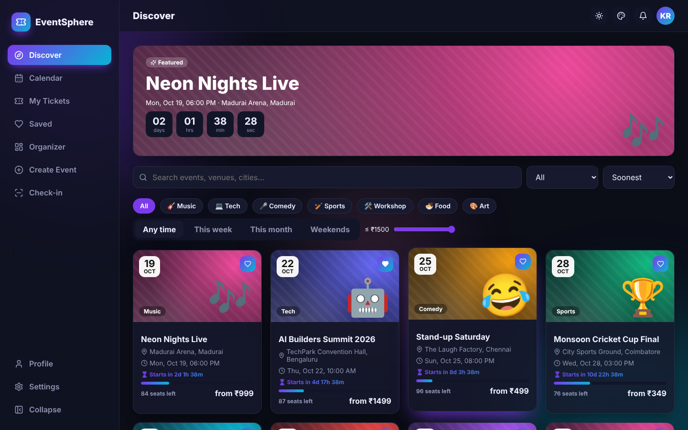
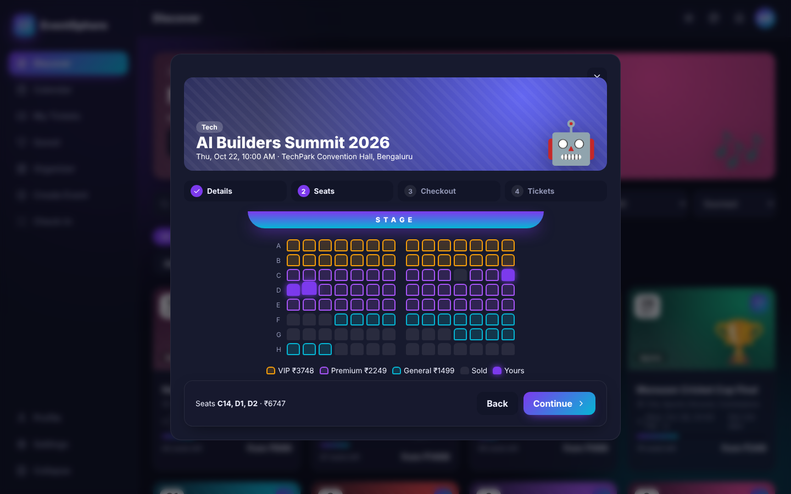
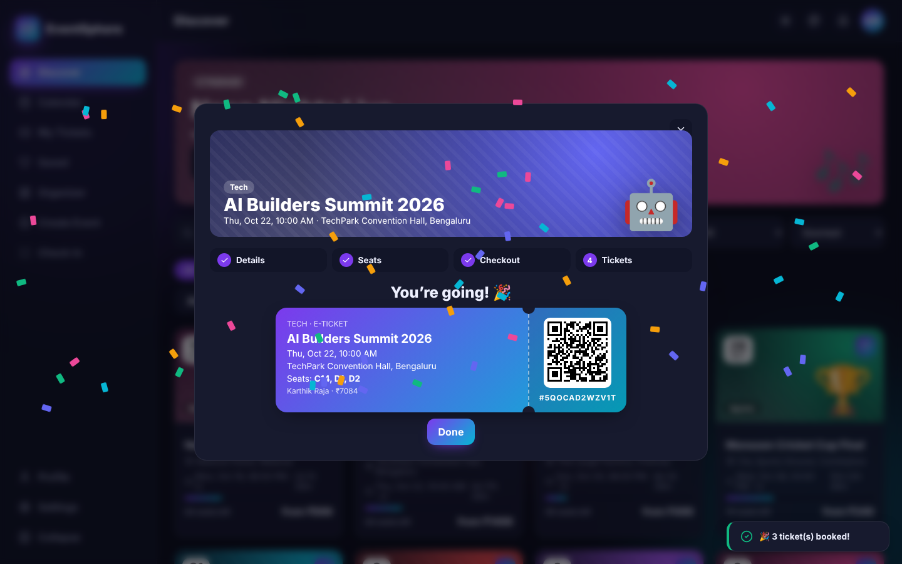
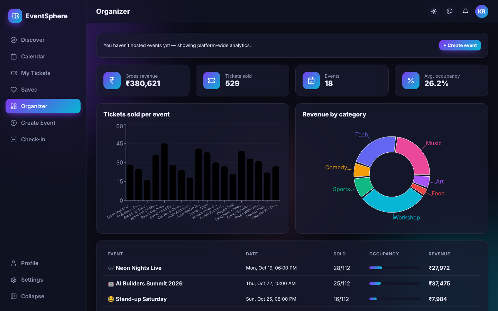
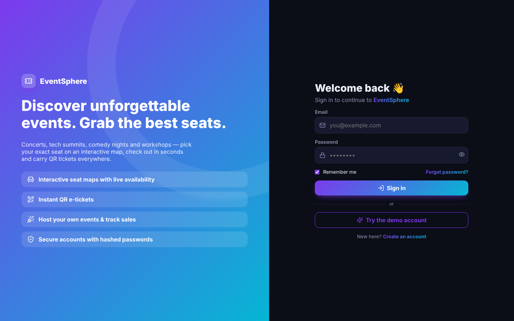
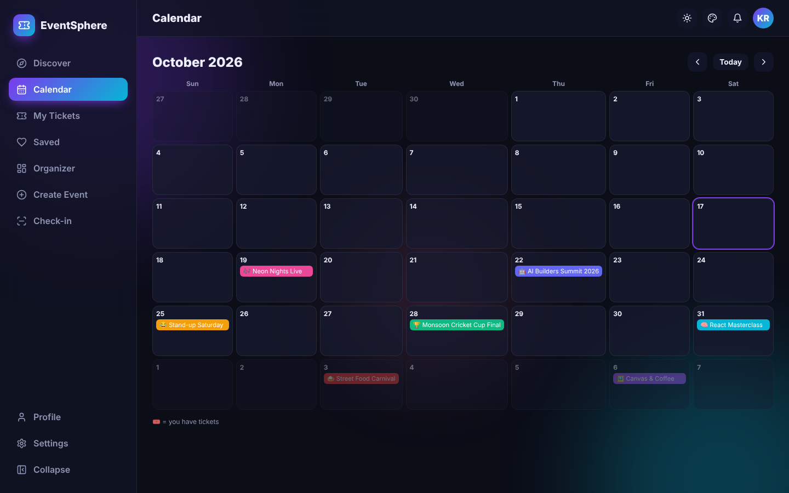

<div align="center">

# 🎟️ EventSphere

### Event discovery & ticketing — interactive seat maps, promo codes, QR e-tickets, organizer analytics and gate check-in


</div>



## ✨ Features

| Area | What you get |
|---|---|
| 🔐 **Auth** | Register & login with salted SHA-256 hashing, password-strength meter, remember-me, demo account, protected routes, profile & password management |
| 🧭 **Discover** | Featured event with live countdown, search, category chips, city, date windows (this week / month / weekends), price slider, 3 sort modes, “only N left” urgency indicators |
| 💺 **Seat selection** | Interactive stage-facing seat map with VIP / Premium / General tiers and prices, live sold-seat availability, up to 6 seats per order |
| 🛒 **Checkout** | 4-step flow (Details → Seats → Checkout → Tickets), attendee details, promo codes (`EARLY10`, `STUDENT20`), booking fee, demo wallet payment, **confetti** celebration |
| 🎫 **QR e-tickets** | Boarding-pass style tickets with scannable QR codes, upcoming / past / cancelled tabs, print & cancel |
| 📆 **Calendar** | Month grid with colour-coded events and markers for events you hold tickets to |
| 📊 **Organizer** | Revenue, tickets sold, occupancy KPIs, per-event sales bar chart, revenue-by-category donut, event table |
| ➕ **Create event** | Category, date/time, venue, pricing, configurable seat layout (rows × seats), banner icon, live preview |
| ✅ **Check-in** | Gate scanner screen — verify ticket IDs, block duplicates & cancelled tickets, recent check-ins feed |
| 🎨 **Themes** | Light / Dark / Midnight / Sepia / System · 6 accents · radius slider · compact & reduced-motion modes |
| 🎞️ **Animations** | Countdown timers, seat pop & glow, step indicators, ticket pop-in, scanner sweep, confetti, staggered cards |

## 🖼️ Screenshots

| Seat map | QR ticket | Organizer |
|---|---|---|
|  |  |  |

| Login | Calendar |
|---|---|
|  |  |

## 🚀 Getting started

```bash
git clone https://github.com/PreciousBharath/EVENTSPHERE-EVENT-TICKETING-APP.git
cd EVENTSPHERE-EVENT-TICKETING-APP
npm install
npm run dev
```

Demo login: `demo@eventsphere.app` / `Demo@1234`, or register.

## 🧱 Structure

```
src/
├── data.js        # Categories, seeded events, seat tiers, pre-sold seat model, promo codes
├── events.jsx     # Events, orders, saved events, check-in logic
├── auth.jsx · theme.jsx · toast.jsx · storage.js
├── components/    # Event (EventCard, SeatMap, EventModal checkout, TicketView, Countdown), Layout…
└── pages/         # Discover, Calendar, Tickets, Organizer, Create, Checkin, Login, Register…
```

## 🛠️ Tech stack

React 18 · React Router 6 · Recharts · qrcode.react · Lucide icons · Vite · CSS animations · Web Crypto API · localStorage

> Demo checkout only — no real payments are processed.

## 📄 License

MIT © [Bharath](https://github.com/PreciousBharath)
